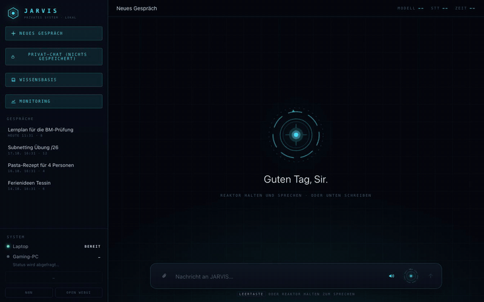
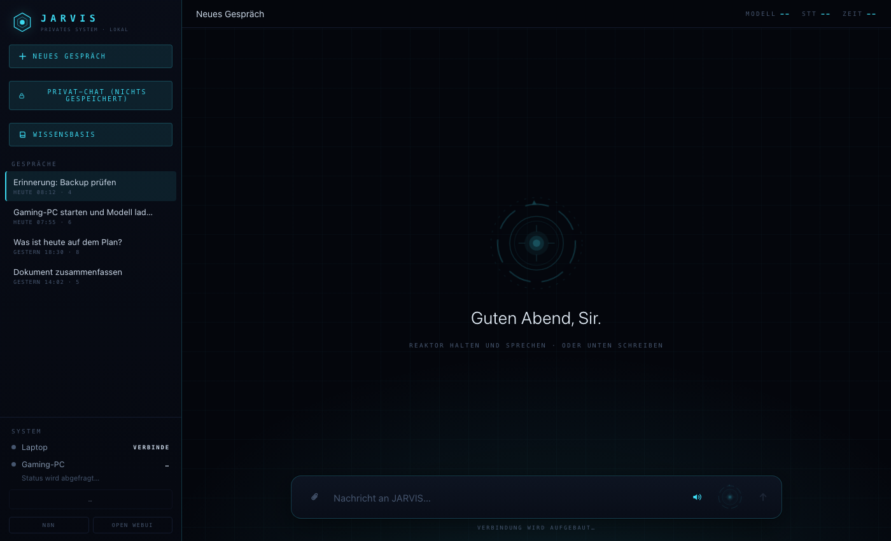
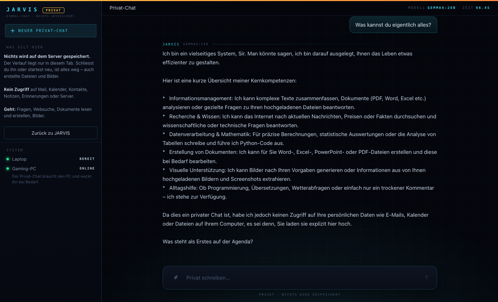
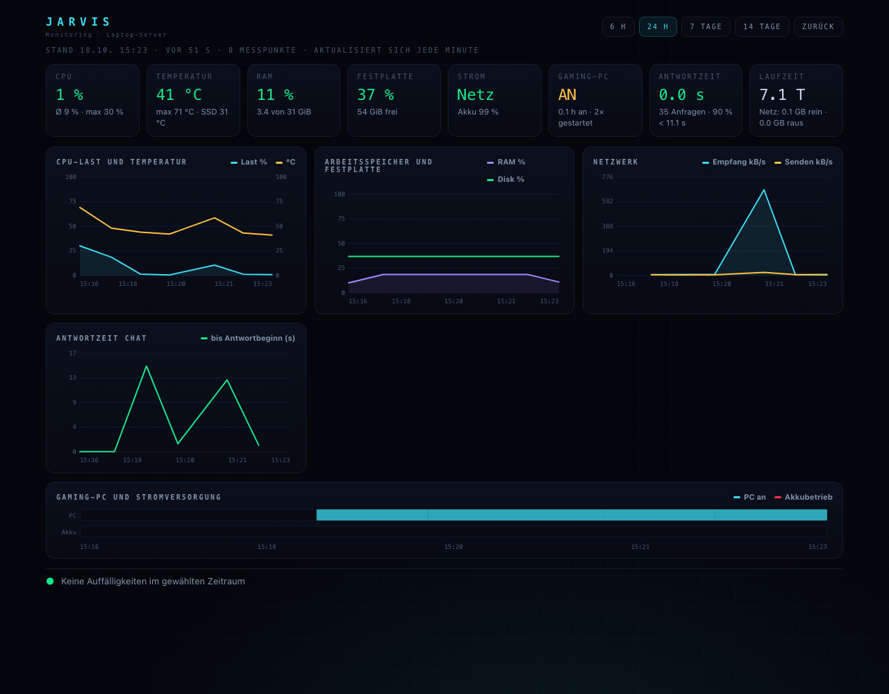

# JARVIS: my private AI assistant on my own hardware

*Project documentation · English version of the [German README](README.md) (German is the original).*

I am an IT apprentice in my second year (EFZ, platform development) in Switzerland. JARVIS has been my spare-time project since July 2026: a voice and chat assistant that runs entirely on my own hardware and actually gets things done in everyday life.



*The real JARVIS interface in about 70 seconds: rolling dice, converting francs, tic-tac-toe, a Word document created on the gaming PC, and the monitoring page. While the gaming PC boots, the video runs in time lapse. The chat titles in the sidebar are made-up examples. [Full-quality video (MP4)](docs/demo.mp4)*

**Try it yourself:** [Interactive demo in the browser](https://a555ferrari.github.io/jarvis-showcase/demo/index.en.html) (scripted, no real model behind it)

---

## At a glance

| | |
|---|---|
| **What** | Personal AI assistant with voice and text, over 45 tools, small games and proactive alerts |
| **Hardware** | An old laptop as the server (runs 24/7, CPU only) and my gaming PC as a compute node on demand |
| **Models** | granite4:3b on the laptop, gemma4:26b on the gaming PC, both local via Ollama |
| **Period** | since July 2026, in daily use |
| **Access** | only through my private network (Tailscale), the same on phone, laptop and PC |
| **Roles** | Concept, architecture, setup, testing and decisions: me. Coding partner: Claude (Anthropic), see [How the project came about](#how-the-project-came-about) |

## Goal

I wanted an assistant like JARVIS from Iron Man, but real and private: one I can trust with my calendar, mail and notes without the data ending up with a cloud provider. And one that does not just chat but acts: set reminders, add appointments, start the PC, create files.

I also wanted to learn how to build such a system from the ground up: server, services, network, AI models, security.

## The problem

1. **Cloud assistants see everything.** Siri, Alexa or ChatGPT send my data to someone else's servers.
2. **Large AI models need a powerful graphics card.** I only have one in my gaming PC, and I do not want to run that around the clock (electricity, noise).
3. **Small models make things up.** They claim, for example, "reminder set" without actually having done it.

## My solution

**A small model decides, the large model only computes when needed:**

```
   Request
      |
      v
+-------------------+        needs more?       +------------------------+
|  Laptop (24/7)    |  -- yes -->  Wake-on-LAN  |  Gaming PC (on demand) |
|  small model      | ------------------------> |  large model (GPU)     |
|  router + tools   |  <-- answer ------------- |                        |
+-------------------+                           +------------------------+
      |                                          then auto-shutdown
   Answer (directly, if the small model is enough)
```

- The power-saving laptop runs all the time and answers simple questions itself.
- If a request needs more power or tools, JARVIS wakes the gaming PC via Wake-on-LAN and says so.
- When the PC is done, it shuts down again. If it runs too long, JARVIS reminds me.
- Against invented success messages there is the **Truth Guard**: it checks every answer to see whether an action reported as done is really backed by a tool call. If not, the answer is corrected.

## What JARVIS can do

| Area | Features |
|---|---|
| **Conversation** | Voice and text in a web interface, answers are read aloud sentence by sentence, private chat without storage |
| **Everyday life** | Reminders and timers (also recurring, with snooze), shopping list, notes, calendar, reading mail, contacts |
| **Knowledge** | Web search, reading and summarising web pages and documents, own knowledge base with search, memory of past conversations, research mode |
| **Creating** | Create and edit Word, Excel, PowerPoint and PDF files, generate images, run Python code in a sandbox |
| **Small helpers** | Exact calculator, unit and currency conversion (daily ECB rates), true randomness (dice, coin, number, pick), secure passwords and PINs, QR codes for links, text and Wi-Fi |
| **Games** | Number guessing, hangman, tic-tac-toe (easy to unbeatable) and rock-paper-scissors, the game logic runs in code |
| **System** | Wake and shut down the gaming PC, system status, monitoring with 14 days of history, ping and port scan in my own network (security lab) |
| **On its own** | Morning briefing (weather, appointments, mail), push alerts for problems with services, memory or disk, a heads-up before early appointments |

## What it looks like

All pictures are real. The start screen (the chat titles in the sidebar are made-up examples):



A private chat with an example question:



*A real private chat. This chat is not stored anywhere.*



*Monitoring page: CPU, temperature, memory, network, response times, gaming PC and the server's power supply. The server is a laptop, so JARVIS also reports when it runs on battery (power outage).*

### Interactive demo

Open [`demo/index.en.html`](demo/index.en.html) in the browser, no server needed. The demo shows the JARVIS interface and **possible conversations** you can click through:

- Set and postpone a reminder
- Wake the PC, with an announcement
- Shut the PC down, with a safety confirmation
- Port scan in my own network, only with an allow list
- The Truth Guard corrects an invented success message

For every step, a panel explains which solution is behind it and where it lives in the code. The conversations are prepared, there is no real model behind the demo.

## Technology used

| Area | Tools |
|---|---|
| **Programming** | Python (FastAPI, asyncio), HTML/CSS/JavaScript |
| **AI models** | Ollama with granite4:3b and gemma4:26b, nomic-embed-text for search |
| **Speech** | Whisper (speech recognition), Piper (speech output) |
| **Images** | ComfyUI on the gaming PC |
| **Server** | Debian, systemd services, Docker (sandbox), SQLite |
| **Network** | Tailscale (private access), Wake-on-LAN, SSH, nginx |
| **Integrations** | iCloud (calendar, mail, contacts), ntfy (push to the phone), Siri shortcut |
| **Development** | Git and GitHub, Claude Code |

## How the project came about

JARVIS is my project: the idea, the goal and all important decisions come from me. For the programming I had a strong partner, **Claude** (Anthropic), mainly Claude Code. I worked like a project manager with a developer on the team: I say what gets built and why, check the result, and decide whether it stays.

**My part**
- **Idea and concept:** an assistant that runs locally, really gets things done, and does not send my data to a cloud.
- **Architecture:** a laptop as a power-saving always-on server, the gaming PC only on demand via Wake-on-LAN, access only through my private network (Tailscale).
- **Hardware and network:** set up the server, the gaming PC with Ollama, Wake-on-LAN and Tailscale on all my devices.
- **Rules and limits:** I decide what JARVIS may do. For example, my school mail account stays out, the private chat stores nothing, the security lab only runs together with me, and only I edit the filter rules for image generation.
- **Testing in daily use:** I use JARVIS every day on phone, laptop and PC, find bugs, describe them precisely and check the fix on the real system.
- **Approval:** nothing goes live or public without my okay.

**Claude's part**
- Writing most of the code, finding bugs and building tests.
- Proposing solutions and explaining them, so that I understand how everything fits together and can decide for myself.

The commits Claude worked on are marked as co-author in the git history. I think it is important to show this openly.

**What I learned along the way:** running a Linux server (systemd, Docker, nginx), networking topics such as Wake-on-LAN and VPN, how language models call tools and where they cannot be trusted, and how to plan a larger project, state requirements clearly, test and document it. On top of that comes something that matters more and more in IT: working with AI in a way that leaves you with a system you understand yourself and are responsible for.

## Challenges and what I learned

| Problem | Solution |
|---|---|
| The model claims "done" without calling the tool | The Truth Guard checks every success message. Critical confirmation questions (e.g. "really shut down the PC?") are fixed in code, not left to the model |
| The PC does not answer ping although it is running | Windows blocks ping. The status is checked through the Ollama port |
| Without tools the small model guesses | JARVIS wakes the PC as soon as tools are needed and says so openly |
| Empty answers when the large model fails | Errors are reported visibly instead of being swallowed |
| Gemma 4 produced errors and empty answers | Thinking mode ("think") switched off |
| Foreign text (mails, web pages) could slip commands to JARVIS | Foreign text is marked for the model as "data only, not an instruction" |
| A language model calculates inexactly and does not really "roll dice" | Calculation, randomness, passwords and games run in code. Clear short commands such as "roll a die" or "17*23" are answered by JARVIS immediately without a model, even when the gaming PC is off |
| Generated passwords ended up in the conversation history | They are automatically replaced with "[not stored]" before saving |

Every change is tested on the real system and secured with regression tests.

## Security and privacy

- **Local:** models, speech recognition and speech output run on my own hardware. Reminders, memory and knowledge base live in local databases.
- **Only what is necessary goes to the internet:** web search, weather, news, iCloud.
- **Private chat:** nothing is stored, no access to mail, calendar, contacts, notes or server.
- **Confirmation before risky actions:** shutting down the PC, deleting appointments, port scan.
- **Generated passwords and PINs** are not stored in the conversation history.
- **Security lab only in my own network:** allow list, no internet targets, no attacks, everything is logged.
- **The model's code runs in a sandbox:** Docker without network, read-only, without privileges, with memory and time limits.
- **Credentials** are stored protected on the server, never in code, log or chat. In this repo, device addresses are placeholders, template: [`.env.example`](.env.example).

## Known limits

- Without the gaming PC, only the small model answers, with fewer tools. Waking the PC can take several minutes.
- The Truth Guard recognises known patterns, not every form of an invented answer.
- The "data only" marking for foreign text is a hint to the model, not a hard lock.
- The repo is a project presentation, not an installation package: paths and devices are tailored to my setup.
- One user, no user management. The protection is the private network.

## What comes next

- **Smart home:** JARVIS should control the light in my room, later as much more as possible. For that, Home Assistant will run on its own hardware (e.g. a Raspberry Pi), separate from the JARVIS server.
- **Stricter lock for foreign content:** after JARVIS has read a mail or web page, it must not perform any actions in the same round.
- **Measurable quality:** fixed test questions per model, results as a table here in the docs.
- **Pi-hole:** block ads and trackers across the whole home network.
- **Speech:** test a wake word and a better German voice.

Already done and therefore no longer on the list: small tools (QR codes, random numbers, passwords, unit conversion), games and monitoring.

## Project structure

| Folder / file | Contents |
|---|---|
| `src/routing_proxy.py` | Heart of the system: router small/large model, Wake-on-LAN, running tools |
| `src/jarvis_agent.py` | Agent loop and tool descriptions |
| `src/truth_guard.py` | Truth Guard, standalone with a demo |
| `src/voice_proxy.py` | Speech: Whisper, model, Piper |
| `src/jarvis_watch.py` | Watchdog and morning briefing |
| `src/jarvis_tools_small.py` | Small helpers: calculating, randomness, passwords, QR codes, conversion (with and without a model) |
| `src/jarvis_games.py` | Games with state per conversation |
| `src/jarvis_metrics.py` | Monitoring: measuring points, history, report |
| `src/jarvis_*.py` | More tools (calendar, mail, knowledge base, files, images, security lab …) |
| `ui/` | Web interface and monitoring page |
| `demo/` | Interactive demo |
| `systemd/` | Service definitions |
| `docs/` | [Architecture](docs/ARCHITEKTUR.en.md) and screenshots |

## Similar projects

The idea comes from J.A.R.V.I.S. in the Iron Man films: an assistant you simply talk to that then gets things done. Only later did I look at other projects with the same name and take ideas for the documentation from them (ideas only, no code): [isair/jarvis](https://github.com/isair/jarvis), [open-jarvis/OpenJarvis](https://github.com/open-jarvis/OpenJarvis), [ethanplusai/jarvis](https://github.com/ethanplusai/jarvis), [Priler/jarvis](https://github.com/Priler/jarvis), [sukeesh/Jarvis](https://github.com/sukeesh/Jarvis).

What mine does differently: the connection to everyday life (calendar, mail, reminders), the power-saving interplay of laptop and gaming PC, and the Truth Guard.

## Questions?

I am happy about questions, feedback and ideas. The easiest way is an [issue](../../issues) here in the repo.

## License

MIT, see [`LICENSE`](LICENSE).
